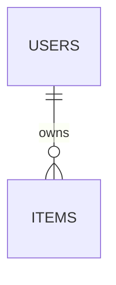

# Database schema — <product>

## ER diagram

## Tables
### <table>
| Column | Type | Null | Default | Constraint | Class |
|---|---|---|---|---|---|
| id | uuid | no | gen_random_uuid() | PK | |
| owner_id | uuid | no | | FK users(id) on delete cascade | |
| created_at | timestamptz | no | now() | | |

Indexes:
Retention / deletion:

## Access matrix (RLS / policy)
| Table | anon | user (own rows) | user (others) | admin | service (server only) |
|---|---|---|---|---|---|

## Migrations
| # | File | Change | Rollback | Risk | Applied (dev/prod) |
|---|---|---|---|---|---|

## Backup & restore
- Backup: provider, frequency, retention, PITR?
- Restore steps:
- Last restore test: date / result
