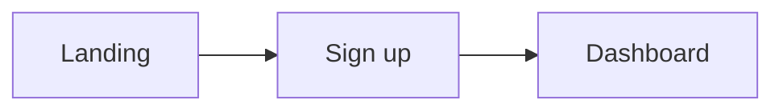

# UI spec — <product>

## Sitemap
## Flows (one per MVP feature)

## Screens
### <screen>
- Purpose (one sentence):
- Primary action:
- Content priority:
- States: loading / empty / error / partial / success
- Mobile notes:

## Design tokens
| Token | Light | Dark | Contrast pair checked |
|---|---|---|---|
Type scale · spacing scale · radius · shadow · motion (duration/easing, reduced-motion fallback)

## Components
| Component | Variants | States (hover/focus/disabled/error) | A11y notes |
|---|---|---|---|

## Approved mock
path/link + date approved
